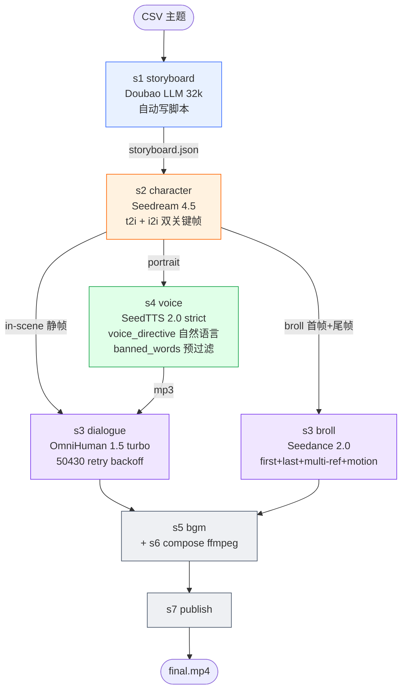
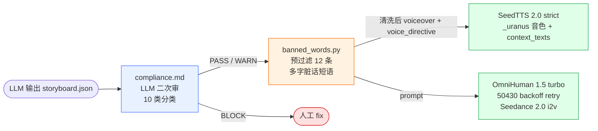

# AI Video Factory 管线方案 v2.1

> v2.1 同步于 2026-05-27,在 v2 基础上整合本会话「4 个模型升级深度审视」实战结论:Seedream 5.0 Lite 是降级（回滚 4.5）/ OmniHuman 480p hard fail（回 720）/ TTS 强制 2.0 + 自然语言情绪 / Seedance 2.0 client 重写深度利用 / s2 反幻觉约束 / OmniHuman 50430 retry / 双关键帧 broll。

---

## 一、需求背景 & 价值

**做什么**：端到端 AI 短视频生产管线。输入主题（CSV），输出 9:16 竖屏 mp4（12-60s），¥18/30s（720p 测试）。

**给谁**：**设备租赁 SaaS 服务商**（众能联合 + 类似企业），用于视频号 / 抖音的**产品宣传 + 品牌树立**。

**核心价值**：

| 维度 | 传统短视频 | AI Video Factory |
|---|---|---|
| 单条成本 | ¥1000+（编剧+拍摄+剪辑） | **¥18 / 30s** |
| 制作周期 | 3-7 天 | 15-25 分钟 |
| 批量化产能 | 4 人团队 ~20 条 / 月 | 单管线 ~100 条 / 月 |
| 品牌一致性 | 靠人工把关 | 题材库 + look 字段 + 否定锚定强制约束 |
| 趣味营销 | 创意全靠人 | 40 行业梗点 × 20 热点模板 = 600 组合候选 |

**关键判断**：单条成本 ¥18 vs 人工 ¥1000+ = **60× 经济优势**。瓶颈不是绝对成本，是 **retry 不稳定** 和 **创意题材库**。本会话工程主线就在解决这两件事。

---

## 二、目标用户 & 使用场景

| 用户类型 | 使用场景 | 内容形态 | 占比 |
|---|---|---|---|
| SaaS 运营 | 视频号矩阵号批量发布 | **趣味段子合集（主力）** | 70% |
| 业务方 / PM | 行业经典案例口播 | 口播形式 | 20% |
| 销售 / 客服 | 客户教育素材 | 揭秘 / 答疑 | 10% |

### 核心使用场景：趣味段子合集

- **每个视频是独立"梗"**：行业反转点 × 短视频热点 —— **不是连续剧**
- **跨视频角色可不一致**：不同段子换"老板/工程师"是 feature 不是 bug
- **同视频内角色必须一致**：中途变脸破戏，是 P0 质量底线
- **时长档**：12s 矩阵号 / 18s 标准 / **30s 完整**（主力）/ 60s 长片

### 不是

- ❌ 单一 IP 连续剧（不需要跨视频严格人脸 ID 一致）
- ❌ 真人拍摄替代（这是补充，不是替换）
- ❌ 大型品牌 TVC（30s 段子定位，不冲刺顶级制作）

---

## 三、核心管线流程（s1 → s7 端到端）



### 单步成本拆解（30s 4 dialogue + 1 broll，720p 测试 + turbo）

| 步骤 | 模型 | 产物 | 成本 |
|---|---|---|---|
| s1 | Doubao LLM 32k | storyboard.json | ¥0.05 |
| s2 | Seedream 4.5 | 2 portrait + 5 scene + 1-2 broll keyframe | ¥2.3 |
| s4 | SeedTTS 2.0 strict + context_texts | 5 × mp3 | ¥0.05 |
| s3 dialogue × 5 | OmniHuman 1.5 turbo 720p | 5 × mp4 | ¥10-15 |
| s3 broll × 1 | Seedance 2.0 i2v 720p | 1 × mp4 | ¥0.5 |
| s5/s6/s7 | bgm / ffmpeg / upload | final.mp4 | ¥0（本地） |
| **合计** | | | **≈ ¥13-18 / 30s** |

---

## 四、关键产物与异常处理

### 4.1 SSOT：`storyboard.json`

整个管线的唯一真理源。3 个 AI（Seedream / SeedTTS / OmniHuman）并行从同一份 JSON 取不同字段。**改能力 = 改字段**，不改代码。

**v2.1 schema 关键字段**（含本会话新增）：

```json
{
  "characters": [{"id", "name", "gender",
                  "voice_id (必须 _uranus_bigtts 系列)",
                  "look (≥80 字 + 粗体 + 否定锚定)"}],
  "narrator": {"voice_id (也必须 _uranus_bigtts)"},
  "shots": [
    // dialogue 镜头(strict 2.0)
    {"idx", "type": "dialogue", "speaker",
     "shot_type", "camera", "lens", "lighting",
     "scene", "scene_dynamics", "action",
     "expression_arc": "起·... → 中·... → 末·...",
     "dramatic_keywords": "怀疑, 算计, 不易察觉的得意",
     "voice_directive": "自然语言情绪+语气+语速+节奏指令 30-60 字",
     "voiceover": "台词 25-45 字",
     "subtitle"
     // emotion / emotion_scale 已废弃 — strict 2.0 不消费
    },
    // broll 镜头(2.0 深度利用)
    {"idx", "type": "broll",
     "scene": "首帧场景",
     "end_scene": "尾帧场景(给 s2 出 last_frame)",
     "scene_dynamics", "lens", "lighting", "prompt",
     "motion_strength": 0.3,    // 0.0-1.0
     "camera_fixed": false,
     "anchor_character": null}
  ]
}
```

### 4.2 异常处理（每 step 失败兜底）

| step | 异常类型 | 兜底策略 |
|---|---|---|
| s1 | LLM 模型未激活 / JSON 不合法 | inject_storyboard.py 加 `rfind('}')` 截断容错;LLM 模型未激活时 FAIL 状态等手动 fix |
| s2 | Seedream 4.5 API 失败 | **自动回退 Seedream 3.0 t2i**（无 reference 但能出图） |
| s4 | TTS 审核词触发 | **banned_words 自动替换 + 同步回写 DB**（不再 retry） |
| s3 dialogue | **OmniHuman 50430 并发限流** | **自动 10s/20s/40s/80s 退避 retry**（本会话新增） |
| s3 dialogue | OmniHuman 50514 音频审核 | banned_words 已挡，剩余 hard fail 等手动改台词 |
| s3 broll | Seedance i2v 超时 | retry-shot 单镜 |
| s6 | ffmpeg 失败 | 重跑 s6（已生成资源不变） |

**关键设计原则**：**单镜失败不死全片**。state machine + SQLite + retry-shot 让任一镜失败可单独修。

---

## 五、角色一致性策略 ⭐

经过 J-VERIFY01 → J-VERIFY04 → 4.5 PoC → **5.0 Lite 实测降级 → 回滚 4.5** → s2 反幻觉修复，**最终方案**：

### 5.1 主路径：Seedream 4.5 i2i + s2 反幻觉约束

`.env`: `IMAGE_PROVIDER=seedream_45`、`SEEDREAM_45_MODEL_ID=doubao-seedream-4-5-251128`

| 阶段 | 走法 |
|---|---|
| 第一张 portrait | Seedream 4.5 t2i + char_id seed + size 1440×2560 |
| 每个 dialogue scene | Seedream 4.5 **i2i + portrait 作 reference image** |
| broll **首帧**关键帧 | Seedream 4.5 t2i/i2i + anchor_character portrait |
| broll **尾帧**关键帧 (本会话新增) | storyboard 给 `end_scene` 时出 `{idx}_broll_end.png` |

### 5.2 prompt-side 三层约束（model-side 不够，必须 prompt 补强）

[s2_character.py:_build_prompt](C:/Users/zhoujianhua3/.claude/skills/ai-video-factory/scripts/factory/steps/s2_character.py) 末尾三条强约束：

1. **单人成画**：`画面里只有这一个角色,严禁出现其他人物、背景人影、对手角色的身影或背影`
2. **严格 look 渲染**：`角色外观必须严格按 look 描述渲染,不要添加描述里没有的头发(如飘起的长发丝)、胡须、配饰`
3. **物件反重力**：`所有物件(纸张、文件、工具、设备)必须自然贴合桌面或被手稳固抓握,严禁悬空漂浮`

look 字段额外约束：

- ≥ 80 字 + **粗体五官** + **否定锚定**（`**面相 X 型,绝非 Y 型**`）

### 5.3 决策依据 + 本会话 5.0 Lite 教训 ⚠️

| 选项 | 推荐度 | 真实评估 |
|---|---|---|
| **Seedream 4.5 i2i** | ⭐⭐⭐⭐⭐ | 4.5 原生支持 1-14 张参考图，火山自家、国内直连、¥0.29/张 |
| ~~Seedream 5.0 Lite (`260128`)~~ | ❌ **实际降级** | **不是 4.5 升级,是平行技术路径**。结构剪枝+量化，**写实质感和人脸细节比 4.5 弱**。强项是跨模态推理/联网检索/指令跟随，**跟段子合集营销需求方向相反** |
| ~~gpt-image-2~~ | ❌ 废弃 | 中国大陆网络/合规问题，且 4.5 已够用 |

**5.0 Lite 教训**：版本号大 ≠ 升级。Lite 在字节家族里是"削减质量换功能/成本"的产品线，**不适合追求画质的场景**。

### 5.4 实测结论

| 实测 | 结论 |
|---|---|
| J-VERIFY04 4.5 PoC | portrait↔scene 一致性比 3.0 大幅提升，"段子合集"诉求完全够用 |
| J-VERIFY05 端到端 | 5 dialogue 全 PUBLISHED，但发现 s2 静帧 3 个 artifact（对手幻觉/纸张漂浮/凭空头发）→ 触发 5.2 三条反幻觉约束修复 |
| 5.0 Lite WebSearch | 字节官方明示"不是 4.5 升级"，人脸细节弱化 → 回滚 4.5 |

---

## 六、合规与稳定性

### 6.1 三道防线



| 防线 | 拦什么 | 实现 |
|---|---|---|
| compliance.md（10 类） | 政治/医疗/金融/未成年/版权/极端情绪/AI 标识/公序良俗/设备租赁敏感/音频禁词 | LLM 二次审，PASS/WARN/BLOCK |
| banned_words.py | OmniHuman/SeedTTS 已知触发词（12 条多字脏话短语） | s4 前文本预过滤 + 同步回写 DB |
| Seedream/OmniHuman API 端 | 火山自家审核 | 触发后 retry-shot 走改写流程 |

### 6.2 工业化稳定性改进（v2.1 累计）

| 风险点 | 修复 | 版本 |
|---|---|---|
| storyboard JSON 末尾 stray 字符（曾烧 ¥15.72） | inject_storyboard.py `rfind('}')` 截断 + 警告 | v2 |
| `你大爷的` 类触发 OmniHuman 50514 | banned_words 自动替换 → `好家伙` | v2 |
| OmniHuman 幻觉对手角色（J-VERIFY04） | s3 prompt 单人成画约束 | v2 |
| **OmniHuman 50430 并发限流（J-VERIFY05）** | **10s/20s/40s/80s 退避 retry**（[omnihuman.py](C:/Users/zhoujianhua3/.claude/skills/ai-video-factory/scripts/factory/clients/omnihuman.py)） | **v2.1** |
| **OmniHuman 480p 公开 API hard fail** | **回 720p,内部生成本来就是 480 再超分** | **v2.1** |
| **TTS 走 1.0 fallback 情绪降级** | **strict 2.0 + voice_directive 自然语言情绪**（_emo_ 音色废弃） | **v2.1** |
| **s2 静帧三类 artifact** | **3 条反幻觉/反重力/严格 look 约束** ([s2_character.py:99-117](C:/Users/zhoujianhua3/.claude/skills/ai-video-factory/scripts/factory/steps/s2_character.py#L99-L117)) | **v2.1** |
| **Seedream 4.5 size <3686400 px** | **client 默认 1440×2560** | **v2.1** |
| **OmniHuman omni_prompt 散文式拼接** | **结构化标签:`camera:` / `emotion:` / `body:` / `background:`**（[s3_shots.py:32-54](C:/Users/zhoujianhua3/.claude/skills/ai-video-factory/scripts/factory/steps/s3_shots.py#L32-L54)），跟 PoC 验证有效的 rich prompt 风格对齐 | **v2.1** |
| **火山账户欠费时 cli.py 直接 crash，shot.error 留 NULL** | omnihuman.py 加 `OmniHumanAccountOverdue(RuntimeError)` 子类 + 关键词识别（overdue / balance / 欠费 / 余额 等），s3_shots._gen_dialogue 加 OAO 分支写 `[ACCOUNT_OVERDUE]` 前缀 + BaseException 兜底防 shot 停留 PENDING | **v2.2** |

---

## 七、成本结构

### 7.1 时长 vs 成本（720p 标准 / turbo 测试）

| 时长 | 典型构成 | 标准 720p | turbo 测试 |
|---|---|---|---|
| 12s 矩阵号 | 2 dialogue, 0 broll | ¥6.5 | ¥4-5 |
| 18s 标准 | 2 dialogue + 1 broll | ¥11.5 | ¥8-9 |
| **30s 完整（主力）** | 4 dialogue + 1 broll | **¥18** | **¥13-15** |
| 60s 长片 | 8 dialogue + 1 broll | ¥35 | ¥25 |

**OmniHuman 占整片成本 60-80%**。省钱杠杆（按 ROI 排）：

1. **OMNIHUMAN_TURBO=true（测试期）**：单镜砍 ~30% 成本
2. **压时长 30s → 12s**：成本砍 64%
3. **720p 不用 1080p**：成本砍 50%
4. **dialogue 数 -1 镜**：省 ¥2-3 / 镜

### 7.2 Retry 风险

| 时期 | 单条期望成本 | Retry 率 | 实际平均成本 |
|---|---|---|---|
| 改造前 | ¥18 | ~50%（JSON 错/审核拦/50430） | ~¥27 |
| 改造后（v2.1） | ¥18 | **<5%**（三道防线 + 50430 backoff + JSON 容错） | **~¥19** |

本会话累计支出 ¥53+ —— 这是改造的直接动机。

---

## 八、能力边界 + 模型深度利用度（v2.1 关键章节）

### 8.1 当前用什么版本

| 组件 | 版本 | model id |
|---|---|---|
| s1 LLM | **Doubao Seed 2.0 Pro**（v2.3 升级，实测扣题+主动 broll+混合分配远胜 1.5） | `doubao-seed-2-0-pro-260215` |
| s2 静帧 | **Seedream 4.5**（回滚自 5.0 Lite） | `doubao-seedream-4-5-251128` |
| s3 dialogue 视频 | OmniHuman 1.5 | `jimeng_realman_avatar_picture_omni_v15` |
| s3 broll 视频 | **Seedance 2.0**（client 深度改造） | `doubao-seedance-2-0-260128` |
| s4 TTS | **SeedTTS 2.0 strict** | resource `seed-tts-2.0` + model `seed-tts-2.0-expressive` |

### 8.2 模型深度利用度（v2.1 审视）

| 模型 | 能力 | 用了吗 |
|---|---|---|
| **Seedream 4.5** | 1-14 张 reference image i2i | ✅ portrait + scene 双图 |
| | 否定锚定 prompt | ✅ look 字段 + 反幻觉 |
| | sequential_image_generation | ⚪ 当前 disabled,逐镜独立调用 |
| **Seedance 2.0** | first_frame | ✅ broll 关键帧 |
| | **last_frame**（本会话新增） | ✅ **storyboard 有 `end_scene` 时双关键帧** |
| | reference_image[] 多图保持角色 | ✅ broll 时 anchor portrait + keyframe 一起喂 |
| | reference_video[] | ⚪ 无素材库 |
| | reference_audio[] | ⚪ 无素材库 |
| | **motion_strength** | ✅ storyboard 字段控（broll 默认 0.3-0.5） |
| | **camera_fixed** | ✅ storyboard 字段控（特写定格） |
| | native audio_output | ⚪ 暂未启用（broll 走 BGM 路径） |
| | @-Tag 跨镜头一致 | ⚪ 待研究 |
| **OmniHuman 1.5** | image + audio + prompt | ✅ |
| | resolution 720/1080 | ✅ 720p（480 公开 API 不支持） |
| | **turbo_mode** | ✅ 测试期开 |
| | **50430 retry backoff** | ✅ 10/20/40/80s |
| | seed | ✅ 默认随机 |
| | mask_url 多角色 | ⚪ s2 反幻觉后无多人静帧场景，不需要 |
| | **emotion/body/camera 自然语言** | ✅ **PoC 已验证**：同 portrait/audio/720p/7s 下，rich prompt 比 baseline 文件大 **+44%**（2.95 vs 2.05 MB），rich 视频表情/身体/镜头变化**显著更丰富**（实测主观判定）→ **prompt 字段真识别自然语言** |
| **SeedTTS 2.0** | strict 2.0 资源 | ✅ TTS_STRICT_V2=true |
| | _uranus_bigtts 音色（22 个） | ✅ 替代废弃的 _emo_*_mars |
| | **context_texts 自然语言情绪** | ✅ voice_directive 字段 30-60 字自然语言 |
| | seed-tts-2.0-expressive 模型 | ✅ |
| | speech_rate 控速 | ✅ |
| | emotion 枚举 | ⚪ strict 2.0 下丢弃 |

### 8.3 能与不能

| 能 | 不能 / 受限 |
|---|---|
| 12-60s 竖屏 9:16 | 横屏 / 方屏（模板未适配） |
| 2-12 个分镜 | 1 或 13+（模型上下文 / 成本） |
| 2-3 角色，清晰 look | 4+ 同框（画面崩） |
| dialogue 主 + 最多 1 broll | 全 broll（破坏情绪连贯） |
| 22 个 _uranus 音色 × voice_directive 自然语言情绪 | 微妙情绪写法待 LLM 调优 |
| Seedream 4.5 文字渲染（短词数字） | 长段落 / 复杂表格 |
| 静帧光线 / 景深 / 构图全可控 | OmniHuman 大运镜（只能小幅推/拉） |
| 单 job 中断续跑 | 跨 job >4 并发 |

---

## 九、演进路径 & 下一步

### 9.1 已完成里程碑

1. **模板字段升级**：13 个分镜字段 + 多情感音色 + emotion → 视频"生动度"上一档
2. **broll 关键帧 + i2v**：Seedance i2v 替代纯 t2v → 多元素场景质量上一档
3. **Seedream 4.5 i2i 接入**：portrait↔scene 一致性升级 → 角色不再"变脸"
4. **题材库 + 否定锚定 + 反幻觉**：内容创意 + look 稳定性 + 单人成画
5. **工业化稳定性 v1**：banned_words / JSON 容错 / 4.5 fallback → retry 率 50% → <10%
6. **v2.1 模型升级实战（本会话）**：
   - ⚠️ **Seedream 5.0 Lite 实测降级**，回滚 4.5
   - ❌ **OmniHuman 480p 公开 API hard fail**，回 720p
   - ✅ **TTS strict 2.0** + voice_directive 自然语言情绪 + _uranus 音色
   - ✅ **Seedance 2.0 client 深度改造**：first/last_frame + multi-ref + motion_strength + camera_fixed + audio_output
   - ✅ **OmniHuman turbo_mode + 50430 backoff retry**
   - ✅ **s2 三条反幻觉约束**（单人/严格 look/反重力）
   - ✅ **双关键帧 broll**（首帧 + 尾帧锁定 i2v 起止）
   - ✅ **storyboard.md schema 三层情绪同步**（画面 + 配音 + 动态表情）
7. **v2.3 隔天复盘 3 大改造**：
   - ✅ **成片增强（补 P0）**：每镜烧字幕 + 0-3s hook 大字 + 片尾品牌 CTA 卡 + 轻量 fade 转场（J-VERIFY06 抽帧验证字幕/hook/CTA 全部正确，¥0 本地 ffmpeg）
   - ✅ **混合路线 B（成本砍半）**：dialogue 镜 `render_mode` 分流 —— 情绪爆点 digital_human(OmniHuman) / 铺垫镜 scene(Seedance + 画外音)；s6 mux 通用化（has_audio_stream 判断）
   - ✅ **s1 LLM 升 Doubao Seed 2.0 Pro**：实测同主题 2.0 扣题（1.5 跑题）+ 主动用 broll + render_mode 混合分配合理 + 输出更详细

### 9.2 v2.1 教训沉淀

| 教训 | 启示 |
|---|---|
| 版本号大 ≠ 升级（5.0 Lite < 4.5 写实质感） | 升级前必须对照能力清单，不能凭版本号 |
| 480p 内部生成 ≠ 公开 API 480p | 公开 API 暴露的档位为准，文档要看清 |
| TTS 2.0 自然语言情绪 ≠ emotion 枚举 | 模型迭代时控制接口可能完全变（枚举→自然语言） |
| 静默 fallback 掩盖问题（_emo_ 走 1.0） | strict 模式 + 显式 error 比静默降级好 |

### 9.3 下一步（按 ROI 排）

| # | 任务 | 预算 | ROI |
|---|---|---|---|
| 1 | **OmniHuman prompt 自然语言能力 PoC**（baseline vs rich 对照） | ¥7 | ⭐⭐⭐⭐⭐ |
| 2 | 题材库扩充（40 → 100 梗点 / 20 → 50 模板） | ¥0（人工） | ⭐⭐⭐⭐ |
| 3 | 100 条 / 月批量化生产管线（job 队列 / dashboard / 选题 pipeline） | 工程 1-2 周 | ⭐⭐⭐⭐ |
| 4 | s7 视频号自动发布（当前 RPA 占位） | 工程 3-5 天 | ⭐⭐⭐ |
| 5 | Seedance 2.0 native audio_output 启用 + s6 跟 BGM 混合 | 工程 1 天 | ⭐⭐⭐ |

### 9.4 长期 roadmap

- 火山方舟开放 Seedance 2.0 Pro 后升级（控制台当前未开放 Pro 档位）
- 数据回流（完播率反喂题材库偏好评分）
- 多账号矩阵 + IP 隔离
- 多语种（SeedTTS 支持但模板没适配）

---

## 十、附录

### A. 题材库速查

完整 40 行业梗点 + 20 热点模板见 `references/prompts/topic_library.md`。

**5 类梗点**：A1 价格陷阱 / A2 设备品控 / A3 合同责任 / A4 服务履约 / A5 行业潜规则
**5 类模板**：B1 反差 / B2 揭秘 / B3 对话 / B4 自嘲 / B5 维权（合规风险高慎用）

**组合公式**：`A#X + B#Y` → 600 个候选题材

### B. 命令速查

```powershell
# 跑一批
& ".venv\Scripts\python.exe" "scripts\cli.py" run "templates\<csv>"

# 看状态 / 花费
... cli.py status
... cli.py cost

# 看单 job 详情
... cli.py inspect <job_id>

# 重试单镜（不重做全片）
... cli.py retry-shot <job_id> <idx>

# 重试整 job
... cli.py retry <job_id>

# 跳过 s1，注入手工 storyboard.json
& ".venv\Scripts\python.exe" "scripts\inject_storyboard.py" <json> <job_id> <title>

# PoC: Seedream 4.5 i2i 一致性
& ".venv\Scripts\python.exe" "scripts\seedream_45_test.py"

# PoC: OmniHuman prompt 自然语言能力(本会话新增)
& ".venv\Scripts\python.exe" "scripts\omnihuman_prompt_capabilities_test.py"
```

### C. 关键文件清单（v2.1）

| 文件 | 作用 |
|---|---|
| `.env` | provider 开关 + secrets + `TTS_STRICT_V2` + `OMNIHUMAN_TURBO` |
| `references/prompts/storyboard.md` | s1 LLM 主 prompt（含 voice_directive / broll 2.0 字段 / 三层情绪同步规则） |
| `references/prompts/topic_library.md` | 题材库（梗点 + 模板） |
| `references/prompts/compliance.md` | 合规审查 + 音频禁词表 |
| `references/voices/seedtts_v2_catalog.yaml` | 38 音色（22 个 _uranus + 14 个 _emo_ 1.0 资源标记不兼容 strict） |
| `scripts/factory/clients/seedream_45.py` | 4.5 i2i 客户端 |
| `scripts/factory/clients/seedance.py` | **2.0 client 深度改造**：first/last_frame + multi-ref + motion + camera_fixed + audio_output |
| `scripts/factory/clients/omnihuman.py` | **1.5 client + turbo_mode + 50430 backoff retry** |
| `scripts/factory/clients/seedtts_v2.py` | **TTS_STRICT_V2 + _uranus default voice + 1.0 fallback hard fail** |
| `scripts/factory/banned_words.py` | TTS 前文本预过滤 |
| `scripts/factory/steps/s2_character.py` | **三条反幻觉约束 + broll 双关键帧** |
| `scripts/factory/steps/s3_shots.py` | **Seedance 2.0 全字段调用 + OmniHuman turbo** |
| `scripts/factory/steps/s4_voice.py` | **strict 2.0 模式下不传 emotion** |
| `scripts/inject_storyboard.py` | 手工 storyboard 注入（跳过 s1）+ JSON stray 字符容错 |
| `scripts/seedream_45_test.py` | i2i PoC |
| `scripts/omnihuman_prompt_capabilities_test.py` | **本会话新增：OmniHuman prompt 自然语言能力 PoC** |

### D. 历史版本

| 版本 | 时间 | 变更 |
|---|---|---|
| v1 | 2026-05-15 | 初始日志式文档，11 章按时间追加 |
| v2 | 2026-05-26 | 按 ToB PM 标准结构重组，加业务定位 + 用例画像，整合 Seedream 4.5 i2i 决策 |
| **v2.1** | **2026-05-27** | **4 模型升级实战回顾：5.0 Lite 降级回滚 / 480p hard fail 回 720 / TTS strict 2.0 + 自然语言情绪 / Seedance 2.0 深度改造 / OmniHuman 50430 retry / s2 反幻觉 / 双关键帧 broll / 三层情绪同步** |
| **v2.2** | **2026-05-27** | **异常处理加固：OmniHuman 欠费明确识别（`[ACCOUNT_OVERDUE]` 前缀）+ s3_shots BaseException 兜底防 shot 停留 PENDING（J-VERIFY06 充值后续跑实战暴露）** |
| **v2.3** | **2026-05-28** | **隔天复盘 3 大改造：①成片增强（每镜烧字幕 + 0-3s hook 大字 + 片尾品牌 CTA 卡 + 轻量 fade 转场，补 P0 静音观看缺陷，J-VERIFY06 抽帧验证✅）②混合路线 B（dialogue 镜加 render_mode：digital_human 情绪爆点用 OmniHuman / scene 铺垫镜用 Seedance+画外音，成本砍半）③s1 LLM 升 Doubao Seed 2.0 Pro（扣题+主动 broll，实测远胜 1.5）** |
